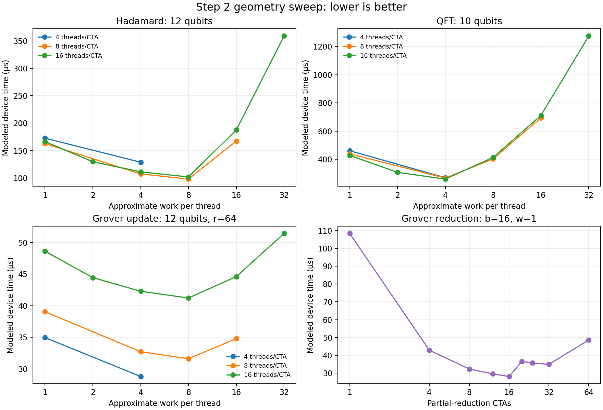

# Step 2: submission and kernel geometry

Measured 27 November 2026 with Vortex SimX (submodule `ca18837`). The modeled device has 16 cores, 4 warps per core, 4 threads per warp, and a 400 MHz clock. The host reports an AMD Ryzen 7 5700U with 2 available physical cores and 4 logical CPUs. These are simulated device results, not timings from a physical GPU.

## Method

Hadamard, Grover, and QFT run unchanged operation sequences through three submission APIs: individual `vx_enqueue_launch` calls, ordered `vx_enqueue_commands`, and `vx_enqueue_draw`. Geometry changes CTA width, grid size, and Grover's partial-reduction CTA count. A grid-stride loop lets each thread handle more than one pair or amplitude. Grover's reduction now explicitly allocates local scratch per CTA; without that allocation, multiple small CTAs on one core corrupted the sum.

The main sweep contains **83 configurations × 3 runs = 249 checked runs**. Every run passed the matched CPU state and algorithm checks. The largest amplitude error was `3.7e-8`; the largest norm deviation was `5.9e-7`. Tables use medians of three process runs. Device cycles were identical across repetitions of each configuration. The CPU baseline is optimized single-threaded C++ (`-O3 -march=native`), measured from five warmed executions inside each process. Qiskit Aer is not part of this comparison.

**Modeled device time = cycles / 400,000 ms.** It is the headline GPU metric. Host enqueue time measures the API calls. Queue wait and execution come from Vortex event profiling; queue wait is a mean per submission and can include backlog. SimX wall time starts before the first launch and ends after state readback. State upload, setup, compilation, and the CPU reference are outside that interval. Queue execution and SimX wall time measure host work, not modeled GPU time.

## Summary

| Circuit | Baseline geometry | Best tested geometry | Cycles, baseline → best | Reduction |
| --- | --- | --- | ---: | ---: |
| Hadamard, 12 qubits | b16, w1 | b8, w8 | 66,508 → 39,170 | 41.1% |
| QFT, 10 qubits | b16, w1 | b16, w4 | 171,146 → 103,878 | 39.3% |
| Grover, 12 qubits, 1 iteration | b16, w1, r64 | b16, w8, r16 | 19,442 → 8,294 | 57.3% |

Here **b** is threads per CTA, **w** is approximate update items per thread, and **r** is Grover partial-reduction CTAs. These are the best of the tested settings at the listed sizes. Even after tuning, modeled GPU time remains above the matched CPU median: Hadamard `0.09793` vs about `0.019` ms; QFT `0.25970` vs about `0.039` ms; and one Grover iteration `0.02074` vs about `0.0035` ms. Step 2 improves the GPU substantially but does not yet meet the project's CPU-speedup goal at these sizes.



## Submission paths

Each cell lists individual / commands / draw. The circuits in this table use the same block size and one item per thread across modes.

| Circuit | Launches | Device cycles | SimX wall time (ms) |
| --- | ---: | --- | --- |
| Hadamard, n=4 | 4 | 3,122 / 3,122 / 3,122 | 69 / 98 / 102 |
| Hadamard, n=12 | 12 | 66,508 / 66,457 / 66,457 | 4,541 / 4,405 / 4,310 |
| Grover, n=4, 3 iterations | 9 | 11,598 / 11,556 / 11,556 | 240 / 299 / 292 |
| Grover, n=8, 12 iterations | 36 | 54,156 / 54,131 / 54,130 | 1,593 / 1,737 / 1,795 |
| QFT, n=4 | 12 | 10,918 / 10,918 / 10,918 | 256 / 316 / 333 |
| QFT, n=10 | 60 | 171,146 / 171,094 / 171,105 | 8,517 / 8,937 / 8,849 |

For the longer cases, event profiling separates API time from queue-worker time (same mode order):

| Circuit | Host enqueue (μs) | Queue execution (ms) |
| --- | --- | --- |
| Hadamard, n=12 | 58.8 / 51.4 / 64.1 | 4,496 / 4,359 / 4,264 |
| Grover, n=8 | 34.2 / 25.0 / 26.6 | 1,589 / 1,731 / 1,787 |
| QFT, n=10 | 44.5 / 28.6 / 52.5 | 8,501 / 8,920 / 8,832 |

The modeled cycle difference between submission modes is at most a few tenths of a percent, and the launch count never changes. The alternate APIs change submission, not the number of device kernels or their barriers. SimX wall time often rises for batched paths. Vortex stages per-launch arguments and descriptors in its queue worker for these paths; this is a plausible source of extra host cost, though the measurements do not isolate it completely. Individual launches already enqueue asynchronously.

A fixed 4-qubit Hadamard state isolates launch count from state size. Each cell again lists individual / commands / draw:

| Launches | Device cycles | Host enqueue time (μs) | SimX wall time (ms) |
| ---: | --- | --- | --- |
| 1 | 797 / 797 / 797 | 19.4 / 21.4 / 20.5 | 18.7 / 26.2 / 28.5 |
| 4 | 3,122 / 3,122 / 3,122 | 22.5 / 23.4 / 44.1 | 72.1 / 96.6 / 102.4 |
| 16 | 12,404 / 12,404 / 12,404 | 53.8 / 22.4 / 22.3 | 272.9 / 368.0 / 379.1 |
| 64 | 49,535 / 49,532 / 49,532 | 44.0 / 27.5 / 25.5 | 1,115.4 / 1,486.6 / 1,533.1 |

An added launch costs about **774 modeled cycles** (`1.94 μs` at 400 MHz) in this tiny circuit. That includes a small Hadamard gate; it is not an empty-kernel launch measurement. At 64 launches, command batching saves roughly `17 μs` in host enqueue calls versus individual enqueue, while SimX wall time rises by hundreds of milliseconds. Host wall time therefore cannot stand in for modeled device time.

## Hadamard geometry

Twelve qubits give 2,048 amplitude pairs and 12 launches. Every row uses individual submission. CTAs are per gate.

| Block | Pairs/thread | CTAs/gate | Cycles | Modeled ms |
| --- | --- | --- | --- | --- |
| 4 | 1 | 512 | 69,029 | 0.17257 |
| 4 | 4 | 128 | 51,477 | 0.12869 |
| 8 | 1 | 256 | 65,053 | 0.16263 |
| 8 | 4 | 64 | 42,948 | 0.10737 |
| 8 | 8 | 32 | 39,170 | 0.09792 |
| 8 | 16 | 16 | 66,876 | 0.16719 |
| 16 | 1 | 128 | 66,508 | 0.16627 |
| 16 | 2 | 64 | 51,823 | 0.12956 |
| 16 | 4 | 32 | 44,445 | 0.11111 |
| 16 | 8 | 16 | 40,735 | 0.10184 |
| 16 | 16 | 8 | 75,017 | 0.18754 |
| 16 | 32 | 4 | 143,624 | 0.35906 |

**b8,w8** is best among tested settings: 32 CTAs, or two per core. More work per thread amortizes indexing and CTA overhead. At b16,w16 only eight CTAs remain, leaving at least half the cores without a CTA; cycles rise. b16,w32 is worse still. b8,w8 is slightly faster than b16,w8, consistent with more schedulable CTAs.

## QFT geometry

Ten qubits produce 60 launches: 10 Hadamards, 45 controlled phases, and 5 swaps. Pair CTAs apply to Hadamards; amplitude CTAs apply to phase and swap kernels. Every row uses individual submission.

| Block | Items/thread | Pair / amplitude CTAs | Cycles | Modeled ms |
| --- | --- | --- | --- | --- |
| 4 | 1 | 128 / 256 | 184,286 | 0.46071 |
| 4 | 4 | 32 / 64 | 107,714 | 0.26928 |
| 8 | 1 | 64 / 128 | 175,485 | 0.43871 |
| 8 | 4 | 16 / 32 | 106,851 | 0.26713 |
| 8 | 8 | 8 / 16 | 161,022 | 0.40255 |
| 8 | 16 | 4 / 8 | 277,982 | 0.69495 |
| 16 | 1 | 32 / 64 | 171,146 | 0.42786 |
| 16 | 2 | 16 / 32 | 122,934 | 0.30734 |
| 16 | 4 | 8 / 16 | 103,878 | 0.25970 |
| 16 | 8 | 4 / 8 | 165,339 | 0.41335 |
| 16 | 16 | 2 / 4 | 284,511 | 0.71128 |
| 16 | 32 | 1 / 2 | 510,016 | 1.27504 |

**b16,w4** is best among tested settings. It reduces the grids to 8 pair CTAs and 16 amplitude CTAs without making thread loops too long. At w8, w16, and w32, the pair passes have only 4, 2, and 1 CTAs; cycles rebound sharply. QFT reaches this crossover earlier than Hadamard because the same work setting controls both pair and amplitude passes, and a 10-qubit pair pass has only 512 tasks.

## Grover geometry

Twelve qubits, one Grover iteration, three launches: partial reduction/oracle, final sum, diffusion. The first table varies update geometry while holding the partial reduction at 64 CTAs. Update CTAs cover 2,048 pairs. Every row uses individual submission.

| Block | Update pairs/thread | Update CTAs | Reduction CTAs | Cycles | Modeled ms |
| --- | --- | --- | --- | --- | --- |
| 4 | 1 | 512 | 64 | 13,988 | 0.03497 |
| 4 | 4 | 128 | 64 | 11,527 | 0.02882 |
| 8 | 1 | 256 | 64 | 15,620 | 0.03905 |
| 8 | 4 | 64 | 64 | 13,093 | 0.03273 |
| 8 | 8 | 32 | 64 | 12,652 | 0.03163 |
| 8 | 16 | 16 | 64 | 13,915 | 0.03479 |
| 16 | 1 | 128 | 64 | 19,442 | 0.04861 |
| 16 | 2 | 64 | 64 | 17,774 | 0.04444 |
| 16 | 4 | 32 | 64 | 16,915 | 0.04229 |
| 16 | 8 | 16 | 64 | 16,486 | 0.04122 |
| 16 | 16 | 8 | 64 | 17,841 | 0.04460 |
| 16 | 32 | 4 | 64 | 20,570 | 0.05142 |

Increasing update work helps until the grid becomes too small. With r64, b16,w8 gives 16 update CTAs; b16,w16 gives only eight and is slower. Changing block size in this table also changes reduction width, so it is not a pure update-pass comparison.

Holding b16,w1 fixed isolates partial-reduction CTA count:

| Reduction CTAs | Max pairs/thread | Cycles | Modeled ms |
| --- | --- | --- | --- |
| 1 | 128 | 43,352 | 0.10838 |
| 4 | 32 | 17,146 | 0.04287 |
| 8 | 16 | 12,952 | 0.03238 |
| 12 | 11 | 11,867 | 0.02967 |
| 16 | 8 | 11,264 | 0.02816 |
| 20 | 7 | 14,638 | 0.03660 |
| 24 | 6 | 14,295 | 0.03574 |
| 32 | 4 | 13,999 | 0.03500 |
| 64 | 2 | 19,442 | 0.04861 |

One CTA serializes too much of the reduction. Sixteen CTAs, matching the core count, is best in this sweep. Twenty or more require another CTA wave and add partial-sum and final-sum work. `-p16` selects 8 CTAs and `-p4` selects 32; both matched the corresponding explicit `-r` runs. All rows were rerun after fixing per-CTA local scratch allocation.

Combining update and reduction settings gives:

| Block | Update pairs/thread | Reduction CTAs | Update CTAs | Cycles | Modeled ms |
| --- | --- | --- | --- | --- | --- |
| 16 | 1 | 16 | 128 | 11,264 | 0.02816 |
| 16 | 2 | 16 | 64 | 9,596 | 0.02399 |
| 16 | 4 | 16 | 32 | 8,744 | 0.02186 |
| 16 | 8 | 16 | 16 | 8,294 | 0.02073 |
| 16 | 16 | 16 | 8 | 9,663 | 0.02416 |
| 8 | 8 | 16 | 32 | 10,245 | 0.02561 |
| 8 | 4 | 32 | 64 | 9,579 | 0.02395 |
| 8 | 8 | 32 | 32 | 9,127 | 0.02282 |

The best tested combination is **b16,w8,r16**: 16 CTAs in both parallel passes and `8,294` cycles, 57.3% below b16,w1,r64. This still uses three launches per iteration; geometry does not remove the global reduction barriers.

## Core counters and bottlenecks

`VORTEX_PROFILING=1` gives the following single-run core-counter summaries for baseline and best geometry. Loads and stores are reported operations, not bytes transferred:

| Algorithm | Instructions, baseline → tuned | Loads, baseline → tuned | Stores, baseline → tuned |
| --- | ---: | ---: | ---: |
| Hadamard, n=12 | 347,136 → 201,984 | 196,608 → 110,592 | 98,304 → 98,304 |
| QFT, n=10 | 796,096 → 409,856 | 354,560 → 143,360 | 48,640 → 48,640 |
| Grover, n=12 | 65,025 → 29,857 | 36,964 → 20,020 | 12,292 → 9,220 |

The tuned geometries issue fewer instructions and loads. Hadamard and QFT retain the same store count, consistent with the same state updates and less indexing, loop, and CTA work. Grover also writes fewer partial sums when r drops from 64 to 16. The core profile reports scoreboard stalls, so load dependencies remain relevant. It reports aggregate scheduler `idle` percentages above 100% in some runs; those are not physically meaningful and are excluded here. These counters do not cleanly divide all cycles into memory movement versus arithmetic. The small fixed-state launch sweep shows a meaningful dispatch floor, while the larger-size sweeps show that state traversal and instruction/scheduling work dominate beyond it.

## Larger-state transfer check

These are **single runs**, separate from the three-run tuning medians. Grover uses one iteration.

| Circuit | Cycles, baseline → transferred setting | Modeled ms, same order | Reduction |
| --- | ---: | ---: | ---: |
| Hadamard, n=15, b16,w1 → b8,w8 | 642,937 → 366,900 | 1.60734 → 0.91725 | 42.9% |
| QFT, n=12, b16,w1 → b16,w4 | 865,880 → 492,749 | 2.16470 → 1.23187 | 43.1% |
| Grover, n=15, b16,w1,r64 → b16,w8,r16 | 68,181 → 36,223 | 0.17045 → 0.09056 | 46.9% |

The smaller-size selections also improve these larger cases. For 15-qubit Grover at b16,w8, r16 was faster than r32 and r64: 36,223 versus 39,048 and 44,511 cycles. This does **not** measure the full 142-iteration search. The 15-qubit Hadamard and 12-qubit QFT tuned device times remain above their optimized CPU references. Short CPU measurements can fluctuate with host load, so the three-run tables are the main comparison.

## Baselines and reproduction

Use **individual submission** as the current modeled-time baseline. Commands and draw remain available for later noisy and fused circuits, which may have different launch patterns. The validated medium-size settings are:

```bash
make hadamard-simx HADAMARD_QUBITS=12 HADAMARD_BLOCK=8 HADAMARD_WORK=8
make qft-simx QFT_QUBITS=10 QFT_BLOCK=16 QFT_WORK=4
make grover-simx GROVER_QUBITS=12 GROVER_ITERATIONS=1 GROVER_BLOCK=16 GROVER_WORK=8 GROVER_REDUCTION_CTAS=16
```

Regenerate the three-run sweep and optional checks with:

```bash
python3 scripts/benchmark_step2.py --repeats 3
python3 scripts/benchmark_step2.py --no-build --suite validation --repeats 1 --output reports/step2_validation.jsonl
python3 scripts/benchmark_step2.py --no-build --suite profile --repeats 1 --output reports/step2_profiles.jsonl
python3 scripts/plot_step2.py
```

The plot command requires Matplotlib.

The checked records are in `reports/step2_measurements.jsonl`, `reports/step2_validation.jsonl`, and `reports/step2_profiles.jsonl`. The sweep used the default 16-core, 4-warp, 4-thread, L2-enabled Vortex configuration and one algorithm process at a time. The best geometry can change with qubit count, hardware configuration, and added noise. These are validated starting points for Step 3 rather than universal constants.
